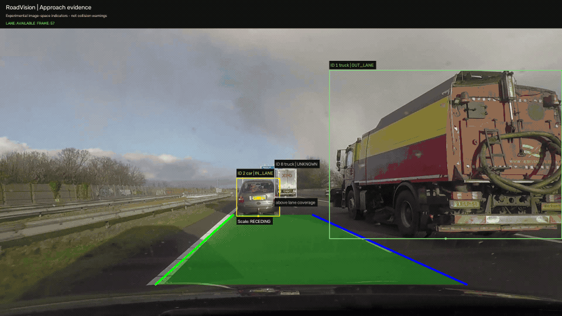
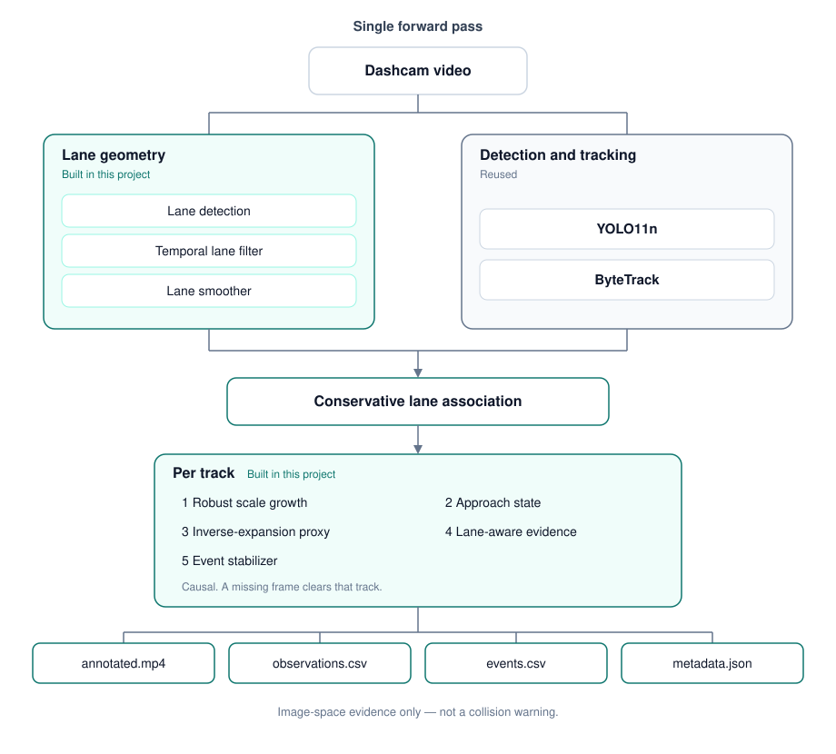
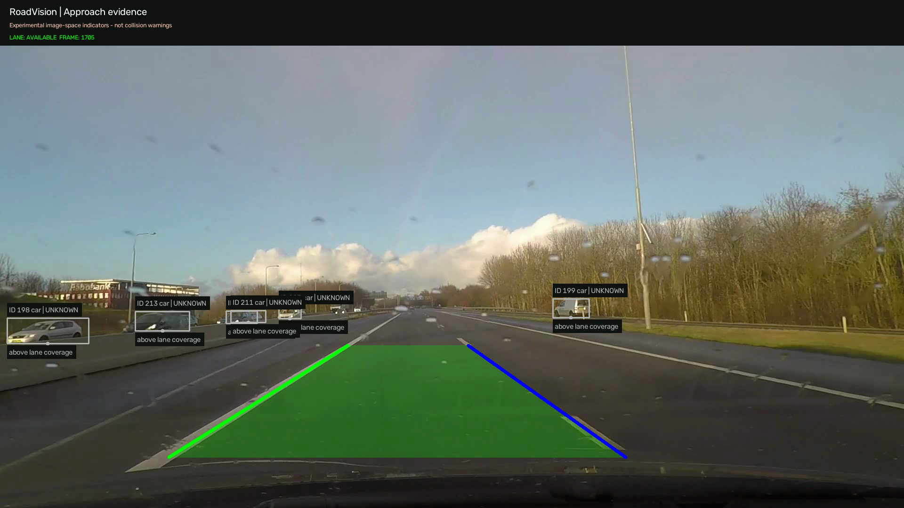

# RoadVision

RoadVision is an experimental driving-video perception pipeline. One forward pass detects road users, tracks them, associates each track with a classical lane fit, and records image-space approach evidence.

This is not a validated collision-warning system, not safety-certified driver assistance, and not a source of physical time-to-collision. Confirmed labels are algorithmic patterns in the image. Do not use them to control a vehicle.

## Demonstration



Yellow is `IN_LANE`, green is `OUT_LANE`, and gray is `UNKNOWN`. Approach text on a box is experimental image-space evidence, not a distance or a warning.

## Architecture



Each frame is processed once. Lane geometry and detection run on that frame, then association, motion, and evidence run per track. A new run starts with new detector, lane, and motion state.

**Reused**

- Pretrained YOLO11n object detector.
- Ultralytics ByteTrack tracking.

**Implemented in RoadVision**

- Classical lane detection and temporal stabilization.
- Conservative vehicle-to-lane association.
- Robust five-frame scale-growth estimation.
- Approach-state classification and inverse-expansion proxy.
- Lane-aware evidence classification and event stabilization.
- Unified video pipeline, configuration, CLI, and regression tests.

YOLO11n and ByteTrack are existing components. The project work is the lane path, the association and evidence rules, and the single-pass application around them. The frame loop and regression are described in [Phase 8 integration](docs/phase8_integration.md).

## Results

The numbers below come from one 1920×1080 recording and a small exploratory review. They are not an independent benchmark. The eight stabilized episodes match the earlier Phase 6 tables. They were not independently verified as physical approach events.

| Measurement | Result |
|---|---|
| Reference video | 1,728 frames, 1920×1080, about 29.97 FPS |
| Tracked observations | 2,656 |
| Track IDs | 68 |
| Detection F1 | 83.87% on 20 reviewed random-subset frames |
| Lane association, strict accuracy | 18.9% of matched random-subset objects |
| Definite lane-association coverage | 27.0% |
| Reproduced Phase 6 episodes | 8/8 |
| Processing throughput | 34.94 FPS average on an Apple M4, MPS |
| Automated tests | 136 passing at the end of Phase 8 |

The lane score is low because many objects sit above the fitted lane and stay `UNKNOWN`. Detection F1 is from that 20-frame review, not a full-video mAP. Throughput is the average over this file on this machine, not camera latency. The label set, tracking gaps, and sensitivity checks are in [Phase 7 evaluation](docs/phase7_evaluation.md).

## Quick start

Tested with Python 3.12.16. Commands are run from the repository root. `requirements.txt` pins the environment used here, including PyTorch, Ultralytics, OpenCV, and pytest.

```bash
python3 -m venv .venv
source .venv/bin/activate
pip install -r requirements.txt
python -c "from ultralytics import YOLO; YOLO('yolo11n.pt')"
```

The last command downloads `yolo11n.pt` into the working directory. The application expects that file before it builds the detector. Weights, the original reference video, and generated experiment CSV files are not stored in Git.

The default device is `mps`. On a machine without Apple Metal, pass `--device cpu` or `--device cuda`. If `mps` or `cuda` is requested and unavailable, the run stops. It does not switch to CPU. Omit `--config` to use the built-in defaults, or pass `--config configs/roadvision.yaml`. Paths are relative to the working directory.

```bash
python -m roadvision run --input path/to/video.mp4 --output runs/demo --max-frames 100
```

`--max-frames 100` is a short smoke test. Omit it to process the whole file. Flags override the loaded settings for that process only.

The output directory receives four files:

- `annotated.mp4` — lane polygon, track id, class, lane color, and any approach label, plus an on-frame disclaimer.
- `observations.csv` — one row per tracked object, including lane status, growth, approach state, evidence, and event state.
- `events.csv` — completed evidence episodes. Zero rows is a valid result.
- `metadata.json` — effective configuration, video properties, counts, and timing.

A missing video, missing weights, or unavailable accelerator prints `error: ...` and exits with status 1.

## Limitations



Vehicles outside the usable lane-geometry region remain `UNKNOWN` instead of being assigned a guessed lane.

- Lane coverage is limited, so `UNKNOWN` is common. Dashes, occlusion, and nearby vehicles also disturb the classical fit.
- Tracks can gap or fragment. A repeated id is a tracker identity, not proof of one physical object.
- Image-space expansion does not establish that a vehicle is approaching. The inverse-expansion proxy is not a measured time to collision.
- There is no validated metric time-to-collision and no collision-warning function.
- The manual review uses one recording and a small, partly prediction-informed annotation set.

## Repository

| Path | Contents |
|---|---|
| `roadvision/` | Unified application and CLI |
| `src/` | Perception and motion algorithms |
| `scripts/` | Experiments and evaluation |
| `tests/` | Automated validation |
| `docs/` | Technical notes |

- [Phase 7 evaluation](docs/phase7_evaluation.md) — detection, lane, tracking, and episode audit.
- [Phase 8 integration](docs/phase8_integration.md) — pipeline, full-video regression, and the one approach-label difference.
- [Phase 6 approach evidence](docs/phase6_risk_assessment.md), [Phase 5 distance experiments](docs/phase5_motion_estimation.md), [tracking](docs/tracking_experiments.md), and [association](docs/association_experiments.md) record the earlier choices. Phase 5 is not an input to approach classification.

```bash
python -m pytest tests -q
```

Passing tests check the implemented behavior. They do not certify driving performance. Replay and published-CSV checks skip, rather than fail, when the local reference video or Phase 6 tables are absent. Those artifacts are not part of a fresh clone.

## Continuous integration

Pushes to `main` and pull requests run `python -m pytest tests -q` on Ubuntu with Python 3.12. The job installs `requirements.txt`. It does not download model weights or the reference video. Tests that need those local files skip.
